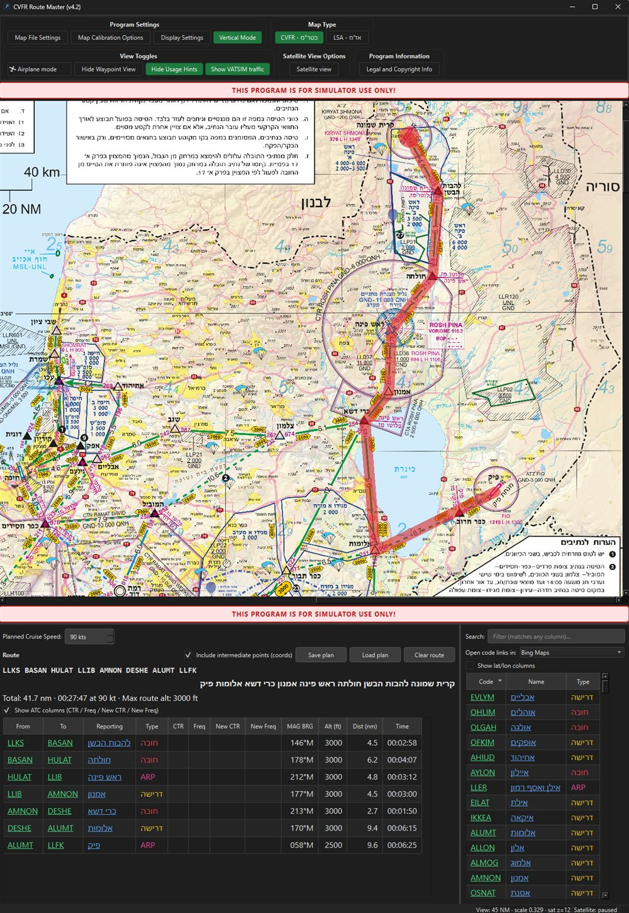
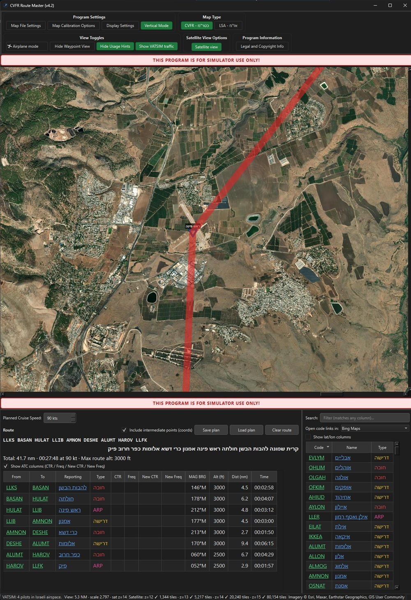
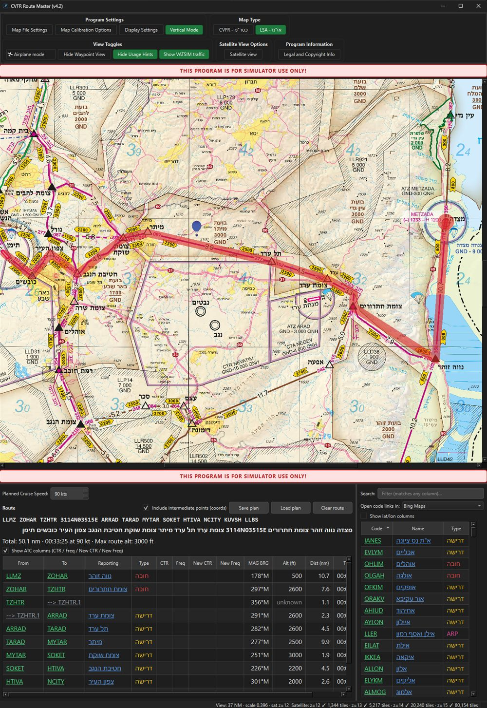
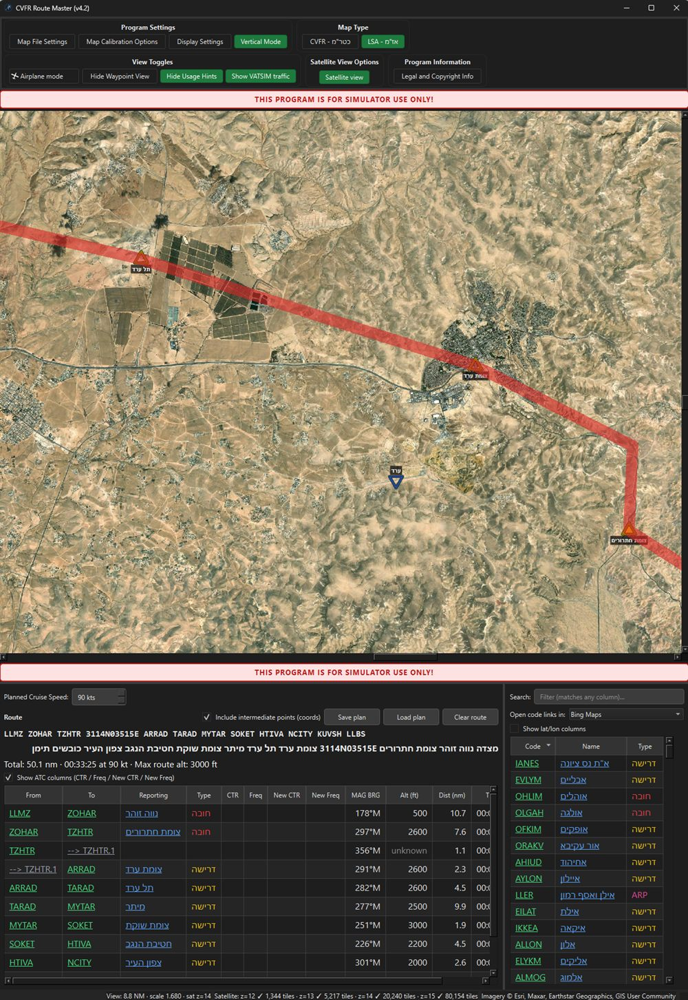

# CVFR Route Master

**CVFR / LSA route planner for flying VFR in Israel on VATSIM** — for MSFS 2020,
MSFS 2024, X-Plane and other flight simulators. Free and open source (AGPL).

**[⬇ Download the latest release (Windows)](https://github.com/cvfr-routemaster/cvfr-routemaster/releases/latest)**
· [Project website](https://cvfr-routemaster.github.io/cvfr-routemaster/)

<p align="center">
  <a href="docs/screenshots/cvfr-map.jpg"></a>
  <a href="docs/screenshots/cvfr-sat.jpg"></a>
  <a href="docs/screenshots/lsa-map.jpg"></a>
  <a href="docs/screenshots/lsa-sat.jpg"></a>
</p>

<div dir="rtl" lang="he">

**[⬇ להורדת הגרסה האחרונה (Windows)](https://github.com/cvfr-routemaster/cvfr-routemaster/releases/latest)**
· [אתר הפרויקט](https://cvfr-routemaster.github.io/cvfr-routemaster/)

עוזר לתכנון מסלולי כטר"מ בישראל, לשימוש בסימולטורי טיסה.

התוכנה CVFR Route Master עוזרת לטייסי VATSIM לתכנן וללמוד מסלולים לטיסות כטר"מ
בישראל, הן במסלולי GA-CVFR (שייקראו בהמשך המסמך פשוט כטר"מ) והן במסלולי
LSA-CVFR (שייקראו בהמשך המסמך פשוט אז"מ). הכלי משלב את מפת הכטר"מ של רת"א
עם צילומי לוויין, מחשב מרחקים, זמנים וכיוונים בין נקודות דרך (הן נקודות
הדיווח הרשמיות והן נקודות ביניים שרירותיות לפי הצורך — למשל בקטעים סביב
יריחו), וקורא את גובהי המסלול מהחצים המודפסים על המפה. ניתן גם לחפש
נקודות דרך לפי שם, לפתוח תצוגת לוויין של נקודת דרך באתרי צילום חיצוניים
(Google, Apple, Bing) ועוד. קיימת גם אפשרות להזין ידנית תדרי בקרה לפני
ההמראה, לפי מה שזמין ברשת באותו זמן.

הכלי מפיק מסלול לתוכנית טיסה בפורמט שקל להעתיק לתוכנית טיסה ב-VATSIM,
וניתן לשמור מסלולים לדיסק ולטעון אותם. המסלול ונקודות הדיווח מוצגים הן
על המפה והן על צילומי הלוויין, כך שקל ללמוד את ציוני הדרך החזותיים לאורך
המסלול. הכלי יכול גם להציג תנועה מ-VATSIM, אבל הוא **אינו GPS** — הדיוק
וקצב העדכון שלו זהים לאלה של VATSIM Radar (כל 15 שניות — זו המגבלה
ש-VATSIM מתירה לגישה לשרתים שלה, והכלי מכבד אותה). כשאפשרות התנועה
מופעלת, לכל כלי טיס במרחב האווירי הווירטואלי של ישראל מוצגים: אות קריאה,
סוג כלי הטיס, גובה ומהירות (הצבע מציין את קטגוריית מערבולת השובל).

</div>

An Israel CVFR route-planning assistant for flight-simulator use.

CVFR Route Master helps VATSIM pilots plan and study the route for CVFR
flights in Israel, for both GA-CVFR (called just CVFR in the rest of this document)
and LSA-CVFR (called just LSA in the rest of this document) routes.
It combines the CAAI's CVFR chart with satellite imagery, computes distances,
times and bearings between waypoints (both the official reporting points and
arbitrary intermediate points if needed — for example across segments around
Jericho), and reads route altitudes from the arrows printed on the chart.
You can also search for waypoints by name, open a satellite view of a waypoint
on third-party imagery sites (Google, Apple, Bing) and more. There is also an
option to manually enter control frequencies before takeoff based on what is
available on the network at the time.

The tool produces a flight-plan route in a format that is easy to copy into
a VATSIM flight plan, and routes can be saved and loaded from disk. The
route and reporting points are displayed both on the chart and on the
satellite imagery, making it easy to study visual landmarks along the
route. The tool can also display VATSIM traffic, but it is **not a GPS** —
its precision and update rate are the same as VATSIM Radar (every 15
seconds — this is the limit VATSIM allows for access to their servers, and
the tool honours it). When the traffic option is enabled, for every
aircraft over Israel's virtual airspace it shows: callsign, aircraft type,
altitude and speed (the colour indicates the wake category).

<div dir="rtl" lang="he">

## שימוש בסיסי

1. **אין צורך בהתקנה** — פשוט מחלצים את קובץ ה-7z לכל מקום שרוצים ומריצים
   את קובץ ההפעלה (Windows 11 פותח קובצי 7z ישירות; ב-Windows 10 צריך
   את [7-Zip](https://www.7-zip.org/)). הגרסה הנוכחית בנויה ל-Windows בלבד, אבל ניתן להריץ את
   התוכנה גם מקוד המקור ב-Linux — ראו את הסעיף האחרון במסמך זה.
2. בגלל זכויות יוצרים, הכלי אינו מגיע עם המפה או עם צילומי הלוויין — אבל
   הוא יוריד אותם לשימושכם האישי, בכפוף לתנאי השימוש של כל ספק.
3. בהפעלה הראשונה הכלי מוריד את מפות הכטר"מ מרת"א, ממיר אותן מ-PDF לתמונות
   וטוען אותן למסך הראשי. בשימוש הראשון במפות הכטר"מ או האז"מ התהליך עשוי
   להימשך זמן מה, אך ההפעלות הבאות מהירות. התהליך זהה למפות הכטר"מ
   והאז"מ: מפות הכטר"מ נטענות כברירת מחדל בהפעלה הראשונה, והתהליך חוזר על
   עצמו בפעם הראשונה שעוברים לאז"מ. נא להתאזר בסבלנות — זה עשוי להימשך
   כמה דקות, כי עיבוד תמונות המפה הענקיות מה-PDF לוקח זמן, גם במעבד חזק.
4. לאחר מכן הכלי מתחיל להוריד צילומי לוויין — כ-2 GB בסך הכול, בארבע רמות
   זום שונות (z=12 עד z=15), שבהן הכלי משתמש באופן דינמי לפי מידת הזום
   (תצוגות קרובות יותר מוגשות מאריחים ברזולוציה גבוהה יותר). רמת זום 12
   מורדת ראשונה, אחריה 13, אחריה 14 ולבסוף 15. כל רמה זמינה לתצוגת הלוויין
   מיד כשהורדתה מסתיימת, כך שהתמונות מופיעות די מהר, והרזולוציה הזמינה
   משתפרת ככל שההורדה מתקדמת. ניתן להעתיק את מטמון אריחי הלוויין הקיים
   מגרסה קודמת של התוכנה: פשוט מעתיקים את <code dir="ltr">.cvfr_routemaster/satellite_tiles</code>
   לתיקייה <code dir="ltr">./cvfr_routemaster</code> של הגרסה החדשה. כך חוסכים את זמן ההורדה בין
   גרסאות.
5. מותר לסגור את התוכנה בזמן שהורדה מתבצעת — היא תמשיך בהפעלה הבאה.
6. בפינה הימנית התחתונה של החלון מוצגת התקדמות ההורדה לכל רמת זום. קצב
   ההורדה צנוע בכוונה, כי גם לספק צילומי הלוויין יש תנאי שימוש, והכלי
   מכבד אותם.
7. ניתן להשתמש בכלי במצב מפה בזמן שההורדה מתבצעת.
8. **לתכנון מסלול:** `SHIFT + LEFT CLICK` על נקודות במפה (למשל קודם LLHZ
   הרצליה, אחר כך BAZRA, וכן הלאה).
9. **להסרת נקודה מהמסלול:** `SHIFT + RIGHT CLICK` על נקודה במסלול. יש גם
   כפתור לניקוי המסלול כולו ולהתחלה מחדש.
10. בכמה מקומות בודדים הכיוון המגנטי של קטע יסטה במעלה אחת ממה שמודפס על
    המפה. הסיבה היא שהעיגול במפת רת"א אינו תמיד עקבי, והכלי מחשב כיוונים
    מהקואורדינטות בפועל של הנקודות.
    - סטייה של מעלה אחת אינה משמעותית ב-VATSIM באורכי הקטעים שבישראל.
11. הכפתורים בראש החלון מחולקים לחמש קבוצות:
    1. **הגדרות התוכנה** `[PROGRAM SETTINGS]` — בדרך כלל אין צורך לגעת
       בהן, מלבד **מצב אנכי** `[VERTICAL MODE]`, שמסדר את החלון מחדש למסך
       לאורך (המפה למעלה, וטבלאות המסלול ונקודות הדרך זו לצד זו מתחתיה).
    2. **סוג המפה** `[MAP TYPE]` — מעבר בין מפות הכטר"מ לאז"מ. לכל סוג מפה
       יש מקורות, כיול, נקודות דרך ומסלול משלו.
    3. **מה מוצג על המסך** `[VIEW TOGGLES]`:
       - **מצב טיסה** `[AIRPLANE MODE]` — מצב של תוכנית טיסה בלבד (בלי
         מפה).
       - **הסתרת רשימת נקודות הדרך** `[HIDE WAYPOINT VIEW]` — כדי לפנות
         מקום על המסך.
       - **הסתרת טקסט העזרה שעל המסך** `[HIDE USAGE HINTS]`.
       - **הצגת תנועה חיה מ-VATSIM** `[SHOW VATSIM TRAFFIC]` — עדכון כל 15
         שניות.
    4. **מצב לוויין** `[SATELLITE VIEW]` — מחליף את המפה בצילומי לוויין של
       ישראל.
    5. **מידע על זכויות יוצרים ורישוי** `[LEGAL AND COPYRIGHT INFO]`.

</div>

## Basic usage

1. **No installation required** — just extract the 7z archive wherever you
   like and run the executable (Windows 11 opens 7z files natively; on
   Windows 10 use [7-Zip](https://www.7-zip.org/)). The current release is built for windows only, but running from source is possible also on Linux, see the bottom section of this document.
2. Due to copyright, the tool does not ship with the chart or the satellite
   imagery — but it will download them for your personal use under the
   respective providers' terms of use.
3. On first launch the tool downloads the CVFR charts from CAAI, converts
   them from PDF to images, and loads them on the main screen. This process can take some time on the first use when the CVFR or LSA maps are chosen, however, subsequent launches are rapid. The process is identical for CVFR and LSA maps, with CVFR being loaded by default on first launch, and the process repeating itself the first time the user switches to LSA. Please be patient, this can take a couple of minutes as rendering the huge map images from PDF takes time, even on a powerful CPU.
4. After that, the tool starts downloading satellite imagery — about 2 GB
   total, across four different zoom levels (z=12 through z=15) which the
   tool uses dynamically depending on how far you are zoomed in (closer
   views are served from higher-resolution tiles). Zoom level 12 is fetched
   first, then 13, then 14, and finally 15. Each level becomes available to
   the satellite view as soon as it finishes, so imagery appears fairly
   quickly and the available resolution improves as the download
   progresses. It is possible to copy the existing satellite tile cache from a previous version of the program, simply copy .cvfr_routemaster/satellite_tiles to the ./cvfr_routemaster folder of your new version. This will save you the download time between versions.
5. It is fine to close the program while a download is in progress — it
   will resume on the next launch.
6. The bottom-right of the window shows download progress for each zoom
   level. The download rate is intentionally modest because the satellite
   imagery provider also has terms of use and the tool honours them.
7. You can use the tool in chart mode while the download is in progress.
8. **To plan a route:** `SHIFT + LEFT CLICK` on points on the chart (for
   example LLHZ Herzliya first, then BAZRA, and so on).
9. **To remove a point from the route:** `SHIFT + RIGHT CLICK` on a point
   in the route. There is also a button to clear the entire route and
   start over.
10. There are a few isolated locations where the magnetic bearing of a
    segment will be off by one degree from what is printed on the chart.
    The reason is that the CAAI chart's rounding is not always consistent
    and the tool computes bearings from the actual coordinates of the
    points.
    - A one-degree deviation is not a meaningful issue for VATSIM at the
      segment lengths involved in Israel.
11. The buttons across the top of the window are split into five groups:
    1. **Program settings** `[PROGRAM SETTINGS]` — you generally will not
       need to touch these, except **Vertical Mode** `[VERTICAL MODE]`,
       which rearranges the window for a portrait monitor (map on top,
       route and waypoint tables side by side below it).
    2. **Map type** `[MAP TYPE]` — switches between the CVFR and LSA
       charts. Each map type keeps its own sources, calibration,
       waypoints and route.
    3. **What you see on screen** `[VIEW TOGGLES]`:
       - **Airplane mode** `[AIRPLANE MODE]` — flight-plan-only mode (no
         chart).
       - **Hide the waypoint list** `[HIDE WAYPOINT VIEW]` — to free up
         screen space.
       - **Hide the on-screen help text** `[HIDE USAGE HINTS]`.
       - **Show live VATSIM traffic** `[SHOW VATSIM TRAFFIC]` — 15-second
         update interval.
    4. **Satellite mode** `[SATELLITE VIEW]` — swaps the chart for
       satellite imagery of Israel.
    5. **Copyright and licensing information** `[LEGAL AND COPYRIGHT INFO]`.

<div dir="rtl" lang="he">

## מגבלות שימוש וזכויות יוצרים

***תוכנה זו אינה מיועדת לשימוש בתעופה אמיתית.***

התוכנה משוחררת תחת רישיון GNU AGPL. כל אחד רשאי להפיץ אותה מחדש, לשנות
אותה ולהפיץ את השינויים שלו וכו', בתנאי שההפצה עומדת בתנאי ה-AGPL. קוד
המקור מופץ יחד עם התוכנה, והוא כתוב ב-Python. התוכנה חינמית לחלוטין
ותישאר כזו תמיד.

</div>

## Usage limitations and copyright

***This program is NOT intended for use in real-world aviation.***

The program is released under the GNU AGPL license. Anyone is free to
redistribute it, modify it, and redistribute their modifications, etc.,
provided the distribution complies with the AGPL terms. The source code is
distributed alongside the program and is written in Python. The program is
completely free and will always remain so.

<div dir="rtl" lang="he">

## הרצה מקוד המקור וב-Linux

התוכנה כתובה ב-Python, ולכן היא עובדת היטב גם מקוד המקור (התיקייה
`cvfr_routemaster` היא מודול Python עצמאי), כולל ב-Linux.

לשם כך, קודם משכפלים (clone) את המאגר.

בשלב הנוכחי של פיתוח התוכנה יש שתי הסתייגויות להרצה מקוד המקור:

1. צריך לקחת את התיקייה <code dir="ltr">.cvfr_routemaster</code> מקובץ ה-7z של גרסת ה-Windows
   כדי לקבל את נתוני כיול המפות — או לכייל את המפות בעצמכם. לשם כך פותחים
   את תפריט הגדרות המפה, טוענים את קובצי המפה (או מפנים לכתובות האמיתיות
   באתר רת"א), ואז מבצעים את כיול המפה (פשוט עוקבים אחרי ההוראות שעל
   המסך). אם בוחרים בדרך הראשונה, התיקייה <code dir="ltr">.cvfr_routemaster</code> צריכה להיות
   ממוקמת ליד תיקיית המודול `cvfr_routemaster` כדי שהתוכנה תמצא את התוכן
   שלה. אני ממליץ פשוט לקחת את התיקייה מקובץ ה-7z של גרסת ה-Windows
   ולחסוך זמן.
2. צריך ש-tesseract יהיה מותקן כדי לבצע OCR (זיהוי תווים). ב-Debian
   (וב-Ubuntu, Mint וכו') מתקינים אותו כך:

   <pre dir="ltr"><code>sudo apt install tesseract-ocr tesseract-ocr-eng tesseract-ocr-heb</code></pre>

   אם אתם בהפצה אחרת, סביר שאתם יודעים מהן פקודות התקנת החבילות. ב-Windows
   צריך את קובצי ההפעלה של tesseract. קובץ ה-7z של הגרסה כולל תיקייה
   בשם `tesseract` — מעתיקים אותה ליד `cvfr_routemaster`, וזהו.

ודאו שכל מה שמופיע ב-`requirements.txt` מותקן בסביבה (env או venv) שלכם,
ואז:

</div>

```
py -m cvfr_routemaster
```

<div dir="rtl" lang="he">

תהנו!

</div>

## Running from source and on Linux

The program is written in python, so it will happily work from sources (the cvfr_routemaster folder is a self-contained python module), including on Linux.

To do this, first, clone the repo.

There are two caveats for running from source at this stage of the program development:
1. You will need to take the .cvfr_routemaster folder from the windows release 7z archive to obtain the map calibration data. Or you will need to calibrate the maps yourself. To do the latter, open the map settings menu, load map files (or point to the actual URLs on the CAAI site) and then perform the calibration of the map (simply follow the instructions on the screen). The .cvfr_routemaster folder must be placed next to the cvfr_routemaster module folder for the program to pick up the contents, if you opt for this route. I recommend you just take the folder from the windows release 7z archive and save some time.
2. You need tesseract installed to perform OCR. On Debian (and Ubuntu, Mint, etc), install it with: sudo apt install tesseract-ocr tesseract-ocr-eng tesseract-ocr-heb. If you are on a different distro, you probably know what the package install commands are. On windows, you need tesseract executables. The release 7z archive contains a tesseract folder, copy it over next to cvfr_routemaster and you are good to go.

Ensure that you have all of the contents of requirements.txt installed in your env or venv, and then:

py -m cvfr_routemaster

Enjoy!

---

<sub>Keywords: Israel CVFR, LSA-CVFR, VFR Israel, VATSIM Israel, VATIL, CAAI CVFR chart,
CVFR reporting points, flight planning, route planner, MSFS 2020, MSFS 2024, X-Plane,
flight simulator · כטר"מ, אז"מ, מפת כטר"מ, נקודות דיווח, רת"א, טיסת VFR בישראל,
סימולטור טיסה, תכנון מסלול טיסה</sub>
